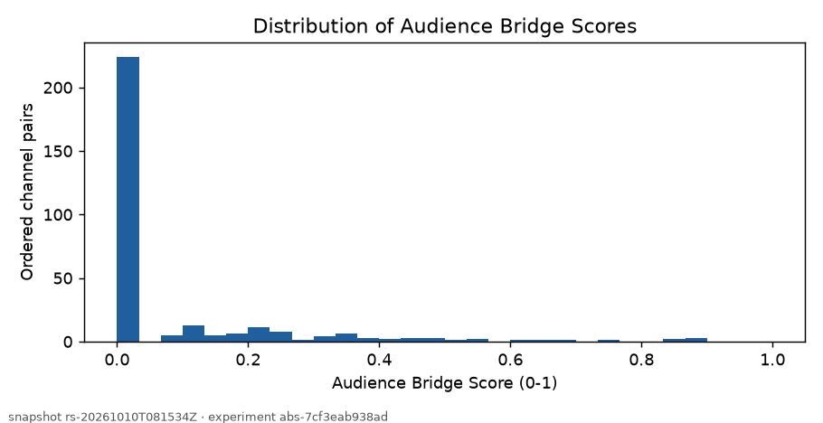
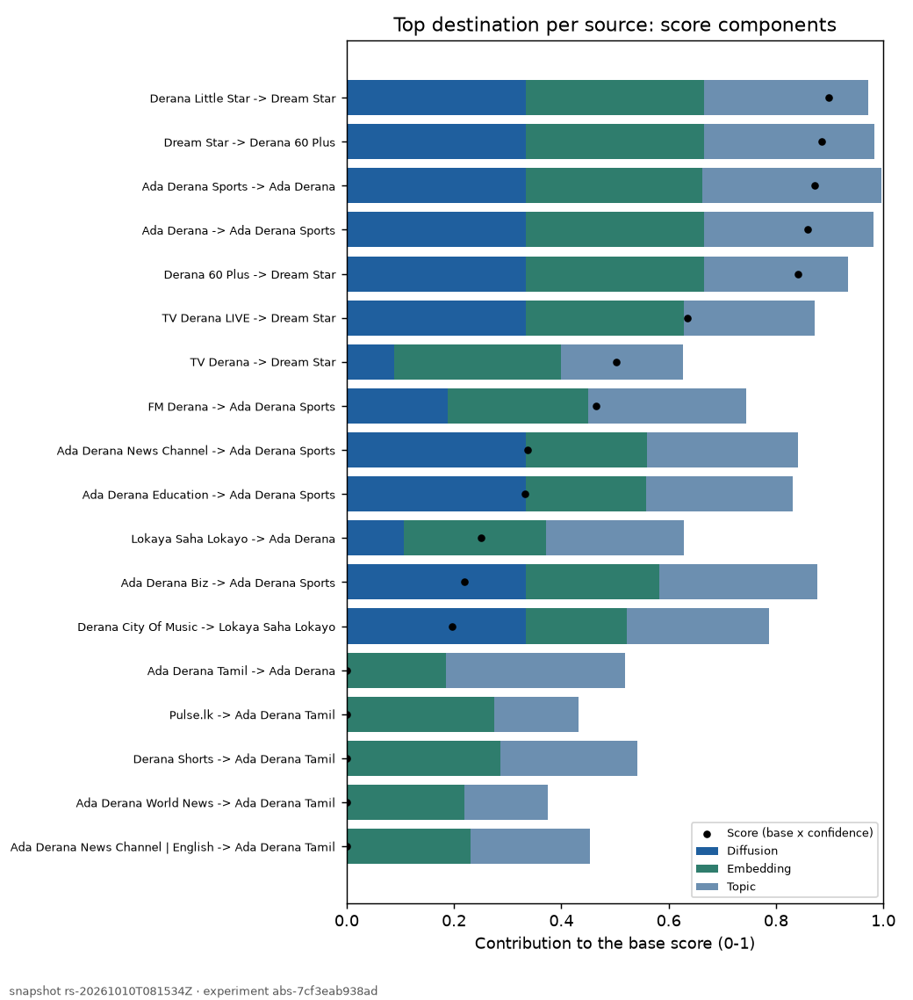
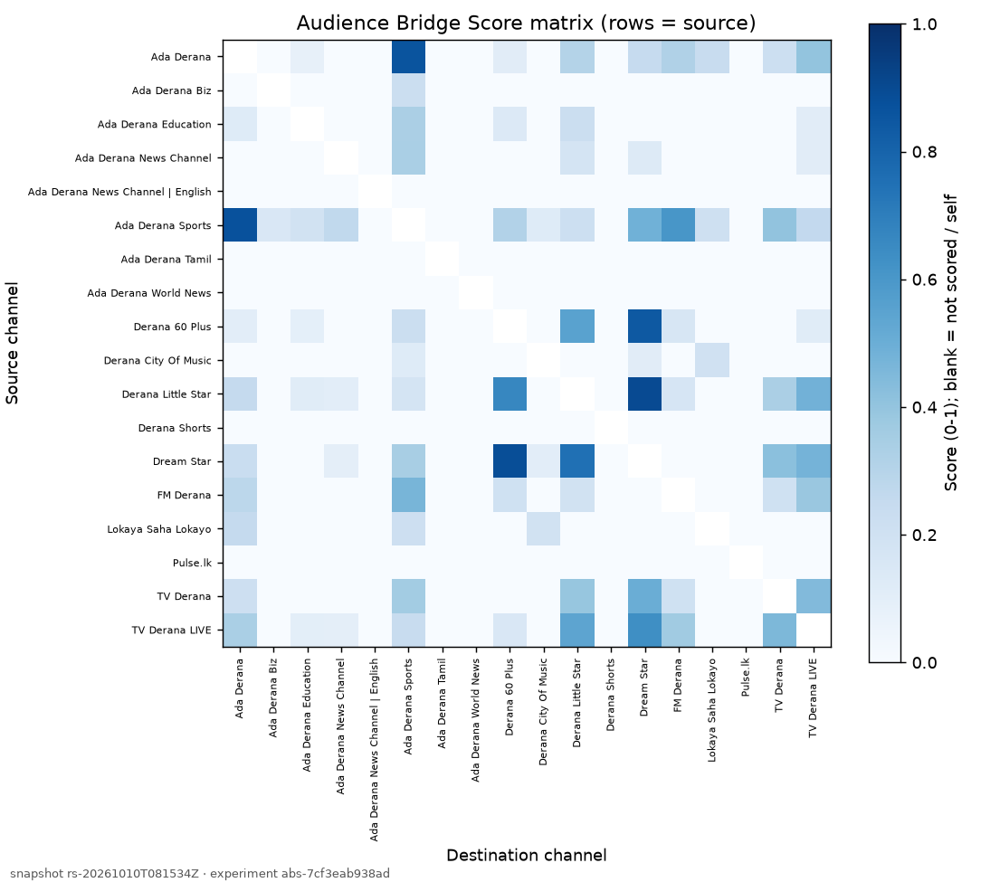
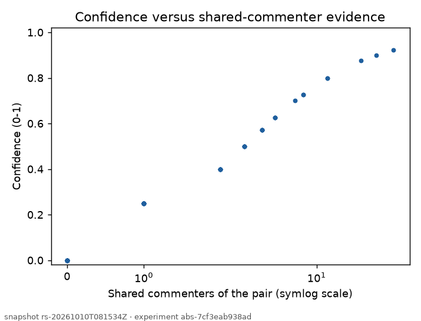
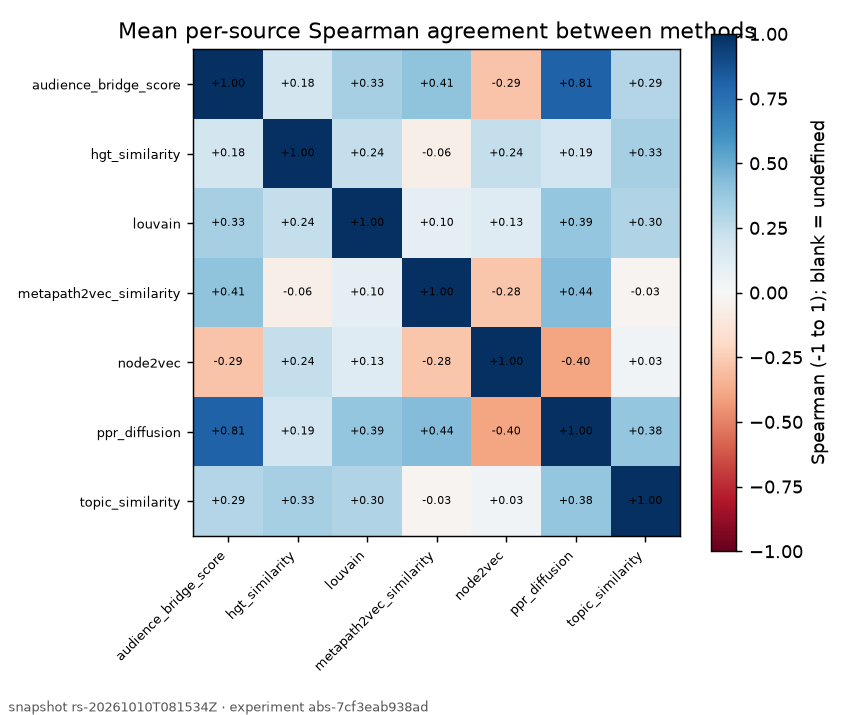
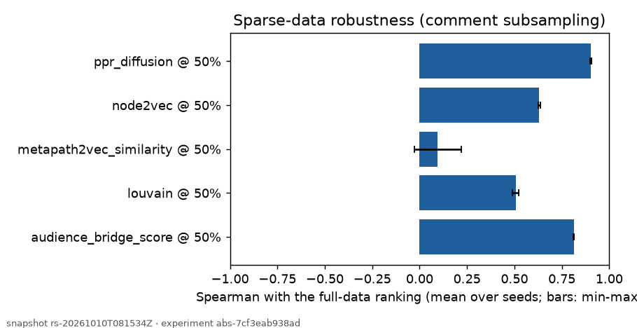
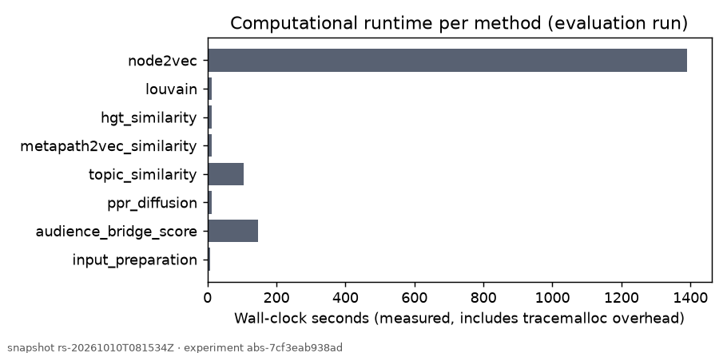

# Component 3 Research Findings: Diffusion-Based Cross-Channel Audience Bridge Scoring

Generated 2026-10-11T06:10:20+00:00 from the persisted artifacts of snapshot `rs-20261010T081534Z` (bridge experiment `abs-7cf3eab938ad`, evaluation `eval-60ac93319497`, explanations `xpl-3baba8a75699`). Reproduce with `python -m research.component_3.findings --snapshot rs-20261010T081534Z`.

> Shared commenter activity and similarity describe aggregate public-comment behaviour; they do not show audience migration, subscriber transfer, causality or future growth. The scoring formula is provisional and no relevance labels exist, so these are descriptive and comparative findings, not validated performance claims.

## 1. Executive summary

- **Data:** 18 of 18 configured channels observed; 851 videos and 10823 public comments (snapshot `rs-20261010T081534Z`).
- **Structure:** 41 of 153 channel pairs share at least one commenter; 5 channel(s) share none with any other channel.
- **Scores:** 306 of 306 ordered pairs scored; median score 0.000, 73.2% of scored pairs are 0 (no shared commenters).
- **Baselines:** mean per-source Spearman of the score with Louvain 0.330, with node2vec -0.286, and with its own diffusion component 0.809 (consistency, not correctness).
- **Ground truth:** relevance metrics were not computed (no labels).
- **Temporal stability:** ok; one comparable pair 1.5 days apart sharing 87% of videos, so stability largely reflects shared data.

## 2. Experiment configuration and provenance

| Item | Value |
|---|---|
| Snapshot | `rs-20261010T081534Z` (supabase_postgresql_experiment, extracted 2026-10-10T08:15:19.525711Z) |
| Observation window | videos 2022-03-06 .. 2026-10-10; comments 2022-03-07 .. 2026-10-10 |
| Collection limits | {'max_videos_per_channel': 50, 'max_threads_per_video': 100, 'fetch_all_replies': True, 'published_since': None} |
| Channel registry | {'owned': 18}; plan gaps: {'competitor': {'expected': 41, 'configured': 0}, 'owned': {'expected': 16, 'configured': 18}} |
| Data quality | VALID_WITH_WARNINGS |
| API requests | 606 requests, 605 quota units |
| Audience Bridge config | {'w_diffusion': 0.3333333333333333, 'w_embedding': 0.3333333333333333, 'w_topic': 0.3333333333333333, 'embedding_source': 'metapath2vec', 'normalization': 'per_source_minmax', 'confidence_k': 3.0} |
| Component experiments | {'diffusion_experiment_id': 'ppr-528039331d78', 'topic_experiment_id': 'top-6bf1e474f003', 'embedding_experiment_id': 'm2v-996c59079f77', 'embedding_method': 'metapath2vec', 'features': 'STEP 14 channel_pair_features as of the snapshot'} |
| Louvain | `louvain-df378406c68c` {'projection_weight': 'jaccard', 'resolution': 1.0, 'threshold': 1e-07, 'seed': 42} |
| node2vec | `node2vec-421e71b0a640` {'dimensions': 64, 'walk_length': 40, 'walks_per_node': 10, 'window': 5, 'p': 1.0, 'q': 1.0, 'negative': 5, 'epochs': 5, 'weighted': True, 'seed': 42} |
| Evaluation | `eval-60ac93319497` {'methods': ['audience_bridge_score', 'ppr_diffusion', 'topic_similarity', 'metapath2vec_similarity', 'hgt_similarity', 'louvain', 'node2vec'], 'ks': [1, 3, 5], 'labels_path': None, 'run_temporal': True, 'temporal_snapshots': None, 'min_depth_ratio': 0.8, 'run_sparse': True, 'sparse_unit': 'comments', 'sparse_fractions': [0.5], 'sparse_seeds': [0, 1], 'sparse_methods': ['audience_bridge_score', 'ppr_diffusion', 'metapath2vec_similarity', 'louvain', 'node2vec']} |
| Versions | {'python': '3.13.2', 'numpy': '2.5.3', 'pandas': '3.0.6', 'scipy': '1.18.1', 'networkx': '3.7', 'platform': '3.13.2'} |

## 3. Dataset and data-quality profile

See the experiment report (`docs/component_3_full_experiment_report.md`) for per-channel coverage. Observed channels: 18/18. Comment counts are bounded by the collection limits and differ with channel size and content, so they are not audience sizes.

## 4. Methodology summary

Heterogeneous commenter-video-channel-topic graph -> metapath2vec (primary) / HGT (alternative) channel embeddings -> Personalized PageRank diffusion -> topic similarity -> confidence weighting -> `score = (w_d diffusion + w_e embedding + w_t topic) x confidence` with weights 0.333 / 0.333 / 0.333 and k = 3.0 (provisional; see docs/architecture/audience_bridge.md). Baselines: Louvain communities on the shared-commenter channel projection and node2vec channel-embedding cosine, on the same snapshot.

## 5. Audience Bridge Score findings

**Measured:** top destination per source (rank 1):

| Source | Destination | Score | Diffusion | Embedding | Topic | Confidence | Shared commenters |
|---|---|---|---|---|---|---|---|
| Derana Little Star | Dream Star | 0.8976 | 0.333 | 0.333 | 0.306 | 0.923 | 36 |
| Dream Star | Derana 60 Plus | 0.8855 | 0.333 | 0.333 | 0.317 | 0.900 | 27 |
| Ada Derana Sports | Ada Derana | 0.8715 | 0.333 | 0.329 | 0.333 | 0.875 | 21 |
| Ada Derana | Ada Derana Sports | 0.8595 | 0.333 | 0.333 | 0.316 | 0.875 | 21 |
| Derana 60 Plus | Dream Star | 0.8408 | 0.333 | 0.333 | 0.268 | 0.900 | 27 |
| TV Derana LIVE | Dream Star | 0.6347 | 0.333 | 0.295 | 0.244 | 0.727 | 8 |
| TV Derana | Dream Star | 0.5017 | 0.089 | 0.309 | 0.229 | 0.800 | 12 |
| FM Derana | Ada Derana Sports | 0.4654 | 0.188 | 0.263 | 0.294 | 0.625 | 5 |
| Ada Derana News Channel | Ada Derana Sports | 0.3364 | 0.333 | 0.226 | 0.282 | 0.400 | 2 |
| Ada Derana Education | Ada Derana Sports | 0.3322 | 0.333 | 0.224 | 0.273 | 0.400 | 2 |
| Lokaya Saha Lokayo | Ada Derana | 0.2511 | 0.106 | 0.266 | 0.256 | 0.400 | 2 |
| Ada Derana Biz | Ada Derana Sports | 0.2193 | 0.333 | 0.249 | 0.295 | 0.250 | 1 |
| Derana City Of Music | Lokaya Saha Lokayo | 0.1966 | 0.333 | 0.189 | 0.264 | 0.250 | 1 |
| Ada Derana Tamil | — (every score is 0: no shared commenters; rank 1 is only a tie-break) | 0.0000 | 0.000 | 0.185 | 0.333 | 0.000 | 0 |
| Pulse.lk | — (every score is 0: no shared commenters; rank 1 is only a tie-break) | 0.0000 | 0.000 | 0.275 | 0.157 | 0.000 | 0 |
| Derana Shorts | — (every score is 0: no shared commenters; rank 1 is only a tie-break) | 0.0000 | 0.000 | 0.286 | 0.255 | 0.000 | 0 |
| Ada Derana World News | — (every score is 0: no shared commenters; rank 1 is only a tie-break) | 0.0000 | 0.000 | 0.219 | 0.157 | 0.000 | 0 |
| Ada Derana News Channel \| English | — (every score is 0: no shared commenters; rank 1 is only a tie-break) | 0.0000 | 0.000 | 0.231 | 0.221 | 0.000 | 0 |

| Measure (scored pairs) | n | Min | Median | Max | Share = 0 |
|---|---|---|---|---|---|
| audience_bridge_score | 306 | 0.000 | 0.000 | 0.898 | 0.732 |
| diffusion_contribution | 306 | 0.000 | 0.000 | 0.333 | 0.490 |
| embedding_contribution | 306 | 0.000 | 0.175 | 0.333 | 0.059 |
| topic_contribution | 306 | 0.000 | 0.265 | 0.333 | 0.059 |
| confidence | 306 | 0.000 | 0.000 | 0.923 | 0.732 |
| evidence_confidence | 306 | 0.000 | 0.000 | 0.923 | 0.732 |
| topic_coverage_confidence | 306 | 1.000 | 1.000 | 1.000 | 0.000 |

**Insufficient evidence:** Ada Derana Tamil: shares no commenter with any other channel, so every score is 0; Ada Derana Biz: fewer than k shared commenters with every other channel (low confidence); Ada Derana Education: fewer than k shared commenters with every other channel (low confidence); Pulse.lk: shares no commenter with any other channel, so every score is 0; Ada Derana News Channel: fewer than k shared commenters with every other channel (low confidence); Derana Shorts: shares no commenter with any other channel, so every score is 0; Ada Derana World News: shares no commenter with any other channel, so every score is 0; Derana City Of Music: fewer than k shared commenters with every other channel (low confidence); Ada Derana News Channel | English: shares no commenter with any other channel, so every score is 0.

**Directional differences:** 153 unordered pairs scored in both directions; median |score(A->B) - score(B->A)| = 0.000, max 0.160; 2 pair(s) are each other's top destination.

| A | B | A->B | B->A | rank A->B | rank B->A |
|---|---|---|---|---|---|
| TV Derana LIVE | Dream Star | 0.6347 | 0.4744 | 1 | 3 |
| Ada Derana Sports | Dream Star | 0.4878 | 0.3435 | 3 | 5 |
| Derana Little Star | Dream Star | 0.8976 | 0.7539 | 1 | 2 |
| Ada Derana Sports | Ada Derana Education | 0.1927 | 0.3322 | 10 | 1 |
| Ada Derana Sports | FM Derana | 0.6034 | 0.4654 | 2 | 1 |
| Derana Little Star | Derana 60 Plus | 0.6678 | 0.5526 | 2 | 2 |
| Derana Little Star | Ada Derana Education | 0.1159 | 0.2208 | 8 | 2 |
| Ada Derana Sports | Derana 60 Plus | 0.3094 | 0.2198 | 5 | 3 |

**Interpretation:** directional differences arise because diffusion is computed from each source and the per-source normalization ranks destinations relative to the source's other candidates; they are properties of the method, not evidence of one-way audience movement.

## 6. Topic and structural relationship analysis

| Most shared commenters (A, B) | Shared | Jaccard |
|---|---|---|
| Derana Little Star - Dream Star | 36 | 0.0195 |
| Derana 60 Plus - Dream Star | 27 | 0.0188 |
| Ada Derana - Ada Derana Sports | 21 | 0.0095 |
| TV Derana - Dream Star | 12 | 0.0061 |
| Derana Little Star - Derana 60 Plus | 12 | 0.0097 |
| Ada Derana Sports - Dream Star | 8 | 0.0034 |
| TV Derana LIVE - Dream Star | 8 | 0.0061 |
| Derana Little Star - TV Derana LIVE | 7 | 0.0064 |

Jaccard over pairs with shared commenters: median 0.0018, max 0.0195. Channels sharing no commenter with any other: Ada Derana News Channel | English, Ada Derana Tamil, Ada Derana World News, Derana Shorts, Pulse.lk.

Topic profiles: 18/18 channels; topic similarity (cosine) median 0.935, range 0.781 .. 0.983; 10 topic clusters.

| Most similar topics (A, B) | Topic similarity |
|---|---|
| TV Derana - TV Derana LIVE | 0.983 |
| FM Derana - Ada Derana Education | 0.976 |
| Derana 60 Plus - TV Derana LIVE | 0.971 |
| TV Derana - Derana Shorts | 0.971 |
| Ada Derana - Ada Derana Biz | 0.970 |
| TV Derana - Ada Derana Education | 0.968 |
| FM Derana - TV Derana | 0.968 |
| Ada Derana Education - Derana Shorts | 0.968 |

## 7. Baseline comparison

**Louvain communities** (modularity 0.193): {Ada Derana, Ada Derana Biz, Ada Derana Sports, Derana City Of Music, Lokaya Saha Lokayo}; {Ada Derana Education, Ada Derana News Channel, FM Derana, TV Derana, TV Derana LIVE}; {Derana 60 Plus, Derana Little Star, Dream Star}; {Ada Derana Tamil}; {Pulse.lk}; {Derana Shorts}; {Ada Derana World News}; {Ada Derana News Channel | English}.

Top-1 destination agreement: node2vec picks the same top destination for 2 of 18 sources; the score's top destination lies in the source's Louvain community for 8 of 18 sources.

## 8. Evaluation results

| Method | Compared with | Metric | Value | Sources | Status |
|---|---|---|---|---|---|
| audience_bridge_score | ppr_diffusion | spearman | 0.809 | 13 | ok |
| audience_bridge_score | ppr_diffusion | kendall | 0.711 | 13 | ok |
| audience_bridge_score | ppr_diffusion | topk_jaccard@1 | 0.833 | 18 | ok |
| audience_bridge_score | ppr_diffusion | topk_jaccard@3 | 0.789 | 18 | ok |
| audience_bridge_score | ppr_diffusion | topk_jaccard@5 | 0.788 | 18 | ok |
| audience_bridge_score | topic_similarity | spearman | 0.294 | 13 | ok |
| audience_bridge_score | topic_similarity | kendall | 0.227 | 13 | ok |
| audience_bridge_score | topic_similarity | topk_jaccard@1 | 0.111 | 18 | ok |
| audience_bridge_score | topic_similarity | topk_jaccard@3 | 0.189 | 18 | ok |
| audience_bridge_score | topic_similarity | topk_jaccard@5 | 0.266 | 18 | ok |
| audience_bridge_score | metapath2vec_similarity | spearman | 0.406 | 13 | ok |
| audience_bridge_score | metapath2vec_similarity | kendall | 0.326 | 13 | ok |
| audience_bridge_score | metapath2vec_similarity | topk_jaccard@1 | 0.222 | 18 | ok |
| audience_bridge_score | metapath2vec_similarity | topk_jaccard@3 | 0.344 | 18 | ok |
| audience_bridge_score | metapath2vec_similarity | topk_jaccard@5 | 0.377 | 18 | ok |
| audience_bridge_score | hgt_similarity | spearman | 0.182 | 13 | ok |
| audience_bridge_score | hgt_similarity | kendall | 0.131 | 13 | ok |
| audience_bridge_score | hgt_similarity | topk_jaccard@1 | 0.111 | 18 | ok |
| audience_bridge_score | hgt_similarity | topk_jaccard@3 | 0.161 | 18 | ok |
| audience_bridge_score | hgt_similarity | topk_jaccard@5 | 0.224 | 18 | ok |
| audience_bridge_score | louvain | spearman | 0.330 | 13 | ok |
| audience_bridge_score | louvain | kendall | 0.308 | 13 | ok |
| audience_bridge_score | louvain | topk_jaccard@1 | 0.444 | 18 | ok |
| audience_bridge_score | louvain | topk_jaccard@3 | 0.461 | 18 | ok |
| audience_bridge_score | louvain | topk_jaccard@5 | 0.513 | 18 | ok |
| audience_bridge_score | node2vec | spearman | -0.286 | 13 | ok |
| audience_bridge_score | node2vec | kendall | -0.219 | 13 | ok |
| audience_bridge_score | node2vec | topk_jaccard@1 | 0.111 | 18 | ok |
| audience_bridge_score | node2vec | topk_jaccard@3 | 0.056 | 18 | ok |
| audience_bridge_score | node2vec | topk_jaccard@5 | 0.065 | 18 | ok |

Relevance metrics (precision, recall, NDCG, MRR): not_computed (labels: none supplied). 'Undefined' means the metric could not be computed, which is different from a computed value of 0.

## 9. Robustness and temporal analysis

**Temporal:** ok
Compared `rs-20261008T191612Z` -> `rs-20261010T081534Z`: 1.5 days apart; 87.3% of the later snapshot's videos and 75.4% of its comments were already in the earlier snapshot. **High stability here largely reflects this shared data; it is not evidence of long-term stability.** Longer, repeated collection is needed.

| Method | Earlier | Later | Metric | Value | Sources |
|---|---|---|---|---|---|
| audience_bridge_score | rs-20261008T191612Z | rs-20261010T081534Z | spearman | 0.946 | 13 |
| audience_bridge_score | rs-20261008T191612Z | rs-20261010T081534Z | kendall | 0.901 | 13 |
| audience_bridge_score | rs-20261008T191612Z | rs-20261010T081534Z | topk_jaccard@1 | 0.944 | 18 |
| audience_bridge_score | rs-20261008T191612Z | rs-20261010T081534Z | topk_jaccard@3 | 0.844 | 18 |
| audience_bridge_score | rs-20261008T191612Z | rs-20261010T081534Z | topk_jaccard@5 | 0.894 | 18 |
| ppr_diffusion | rs-20261008T191612Z | rs-20261010T081534Z | spearman | 0.969 | 13 |
| ppr_diffusion | rs-20261008T191612Z | rs-20261010T081534Z | kendall | 0.913 | 13 |
| ppr_diffusion | rs-20261008T191612Z | rs-20261010T081534Z | topk_jaccard@1 | 0.944 | 18 |
| ppr_diffusion | rs-20261008T191612Z | rs-20261010T081534Z | topk_jaccard@3 | 0.889 | 18 |
| ppr_diffusion | rs-20261008T191612Z | rs-20261010T081534Z | topk_jaccard@5 | 0.857 | 18 |
| topic_similarity | rs-20261008T191612Z | rs-20261010T081534Z | spearman | 0.993 | 18 |
| topic_similarity | rs-20261008T191612Z | rs-20261010T081534Z | kendall | 0.971 | 18 |
| topic_similarity | rs-20261008T191612Z | rs-20261010T081534Z | topk_jaccard@1 | 1.000 | 18 |
| topic_similarity | rs-20261008T191612Z | rs-20261010T081534Z | topk_jaccard@3 | 0.972 | 18 |
| topic_similarity | rs-20261008T191612Z | rs-20261010T081534Z | topk_jaccard@5 | 0.944 | 18 |
| metapath2vec_similarity | rs-20261008T191612Z | rs-20261010T081534Z | spearman | 0.622 | 18 |
| metapath2vec_similarity | rs-20261008T191612Z | rs-20261010T081534Z | kendall | 0.484 | 18 |
| metapath2vec_similarity | rs-20261008T191612Z | rs-20261010T081534Z | topk_jaccard@1 | 0.500 | 18 |
| metapath2vec_similarity | rs-20261008T191612Z | rs-20261010T081534Z | topk_jaccard@3 | 0.417 | 18 |
| metapath2vec_similarity | rs-20261008T191612Z | rs-20261010T081534Z | topk_jaccard@5 | 0.509 | 18 |
| hgt_similarity | rs-20261008T191612Z | rs-20261010T081534Z | spearman | 0.756 | 18 |
| hgt_similarity | rs-20261008T191612Z | rs-20261010T081534Z | kendall | 0.581 | 18 |
| hgt_similarity | rs-20261008T191612Z | rs-20261010T081534Z | topk_jaccard@1 | 0.444 | 18 |
| hgt_similarity | rs-20261008T191612Z | rs-20261010T081534Z | topk_jaccard@3 | 0.400 | 18 |
| hgt_similarity | rs-20261008T191612Z | rs-20261010T081534Z | topk_jaccard@5 | 0.556 | 18 |
| louvain | rs-20261008T191612Z | rs-20261010T081534Z | spearman | 0.791 | 13 |
| louvain | rs-20261008T191612Z | rs-20261010T081534Z | kendall | 0.791 | 13 |
| louvain | rs-20261008T191612Z | rs-20261010T081534Z | topk_jaccard@1 | 0.722 | 18 |
| louvain | rs-20261008T191612Z | rs-20261010T081534Z | topk_jaccard@3 | 0.694 | 18 |
| louvain | rs-20261008T191612Z | rs-20261010T081534Z | topk_jaccard@5 | 0.778 | 18 |
| node2vec | rs-20261008T191612Z | rs-20261010T081534Z | spearman | 0.588 | 18 |
| node2vec | rs-20261008T191612Z | rs-20261010T081534Z | kendall | 0.427 | 18 |
| node2vec | rs-20261008T191612Z | rs-20261010T081534Z | topk_jaccard@1 | 0.111 | 18 |
| node2vec | rs-20261008T191612Z | rs-20261010T081534Z | topk_jaccard@3 | 0.267 | 18 |
| node2vec | rs-20261008T191612Z | rs-20261010T081534Z | topk_jaccard@5 | 0.455 | 18 |

**Sparse data** (seeded comment subsampling; mean, min-max over seeds):

| Method | Retained | Metric | Mean | Min | Max | Seeds |
|---|---|---|---|---|---|---|
| audience_bridge_score | 50% | kendall | 0.742 | 0.739 | 0.745 | 2 |
| audience_bridge_score | 50% | score_coverage | 1.000 | 1.000 | 1.000 | 2 |
| audience_bridge_score | 50% | spearman | 0.814 | 0.811 | 0.816 | 2 |
| audience_bridge_score | 50% | topk_jaccard@1 | 0.722 | 0.667 | 0.778 | 2 |
| audience_bridge_score | 50% | topk_jaccard@3 | 0.694 | 0.672 | 0.717 | 2 |
| audience_bridge_score | 50% | topk_jaccard@5 | 0.769 | 0.762 | 0.775 | 2 |
| louvain | 50% | kendall | 0.506 | 0.491 | 0.521 | 2 |
| louvain | 50% | score_coverage | 1.000 | 1.000 | 1.000 | 2 |
| louvain | 50% | spearman | 0.506 | 0.491 | 0.521 | 2 |
| louvain | 50% | topk_jaccard@1 | 0.667 | 0.667 | 0.667 | 2 |
| louvain | 50% | topk_jaccard@3 | 0.553 | 0.511 | 0.594 | 2 |
| louvain | 50% | topk_jaccard@5 | 0.604 | 0.593 | 0.615 | 2 |
| metapath2vec_similarity | 50% | kendall | 0.076 | -0.013 | 0.166 | 2 |
| metapath2vec_similarity | 50% | score_coverage | 1.000 | 1.000 | 1.000 | 2 |
| metapath2vec_similarity | 50% | spearman | 0.096 | -0.027 | 0.219 | 2 |
| metapath2vec_similarity | 50% | topk_jaccard@1 | 0.222 | 0.111 | 0.333 | 2 |
| metapath2vec_similarity | 50% | topk_jaccard@3 | 0.217 | 0.156 | 0.278 | 2 |
| metapath2vec_similarity | 50% | topk_jaccard@5 | 0.230 | 0.219 | 0.241 | 2 |
| node2vec | 50% | kendall | 0.469 | 0.460 | 0.478 | 2 |
| node2vec | 50% | score_coverage | 1.000 | 1.000 | 1.000 | 2 |
| node2vec | 50% | spearman | 0.631 | 0.625 | 0.637 | 2 |
| node2vec | 50% | topk_jaccard@1 | 0.139 | 0.111 | 0.167 | 2 |
| node2vec | 50% | topk_jaccard@3 | 0.264 | 0.239 | 0.289 | 2 |
| node2vec | 50% | topk_jaccard@5 | 0.423 | 0.386 | 0.461 | 2 |
| ppr_diffusion | 50% | kendall | 0.791 | 0.789 | 0.792 | 2 |
| ppr_diffusion | 50% | score_coverage | 1.000 | 1.000 | 1.000 | 2 |
| ppr_diffusion | 50% | spearman | 0.903 | 0.899 | 0.908 | 2 |
| ppr_diffusion | 50% | topk_jaccard@1 | 0.750 | 0.722 | 0.778 | 2 |
| ppr_diffusion | 50% | topk_jaccard@3 | 0.719 | 0.678 | 0.761 | 2 |
| ppr_diffusion | 50% | topk_jaccard@5 | 0.718 | 0.712 | 0.725 | 2 |

**Runtime** (evaluation run, measured):

| Method | Seconds | Python heap peak (MiB) |
|---|---|---|
| input_preparation | 7.90 | — |
| audience_bridge_score | 146.80 | 633.2 |
| ppr_diffusion | 12.99 | 16.3 |
| topic_similarity | 105.43 | 633.0 |
| metapath2vec_similarity | 13.06 | 21.8 |
| hgt_similarity | 13.06 | 21.8 |
| louvain | 12.24 | 13.6 |
| node2vec | 1391.40 | 56.0 |

Times are wall-clock on the run machine and include any concurrent load (other jobs ran on the same machine during this experiment); they are not controlled benchmarks.

## 10. Explainability examples

Explanation statuses: {'complete': 306}. Reasons: {'no_shared_commenter_evidence': 158, 'high_topic_similarity': 90, 'strong_embedding_similarity': 90, 'insufficient_evidence': 66, 'strong_structural_connectivity': 65, 'low_confidence_sparse_evidence': 42, 'strong_shared_commenter_evidence': 40}.

> Derana Little Star -> Dream Star: rank 1 of 17 scored destinations; Audience Bridge Score 0.8976 = (diffusion 0.3333 + embedding 0.3333 [metapath2vec] + topic 0.3057) x confidence 0.9231. Diffusion provides 34% of the base score. Strong structural connectivity (PPR diffusion): ranks 1 of 17 candidates for this source. Strong embedding similarity (learned graph representation): ranks 1 of 17 candidates for this source. Strong topic similarity: ranks 5 of 17 candidates for this source. 36 shared commenters (at least k = 3).
> Dream Star -> Derana 60 Plus: rank 1 of 17 scored destinations; Audience Bridge Score 0.8855 = (diffusion 0.3333 + embedding 0.3333 [metapath2vec] + topic 0.3172) x confidence 0.9000. Diffusion provides 34% of the base score. Strong structural connectivity (PPR diffusion): ranks 1 of 17 candidates for this source. Strong embedding similarity (learned graph representation): ranks 1 of 17 candidates for this source. Strong topic similarity: ranks 3 of 17 candidates for this source. 27 shared commenters (at least k = 3).
> Ada Derana Sports -> Ada Derana: rank 1 of 17 scored destinations; Audience Bridge Score 0.8715 = (diffusion 0.3333 + embedding 0.3293 [metapath2vec] + topic 0.3333) x confidence 0.8750. Diffusion provides 33% of the base score. Strong structural connectivity (PPR diffusion): ranks 1 of 17 candidates for this source. Strong embedding similarity (learned graph representation): ranks 2 of 17 candidates for this source. Strong topic similarity: ranks 1 of 17 candidates for this source. 21 shared commenters (at least k = 3).

Score sensitivity (top-1 destination kept under each scenario, from stored components):

| Scenario | Sources | Top-1 kept |
|---|---|---|
| confidence_removed | 18 | 9 |
| diffusion_removed | 18 | 16 |
| embedding_removed | 18 | 15 |
| topic_removed | 18 | 17 |
| weights_d0.5_e0.5_t0 | 18 | 17 |
| weights_d0.5_e0_t0.5 | 18 | 15 |
| weights_d0_e0.5_t0.5 | 18 | 16 |
| weights_d0_e0_t1 | 18 | 13 |
| weights_d0_e1_t0 | 18 | 17 |
| weights_d1_e0_t0 | 18 | 15 |

## Findings

**Finding 1 — Cross-channel structural connectivity.** 41 of 153 channel pairs share commenters; overlap is concentrated in a few pairs (top pair Derana Little Star - Dream Star: 36 shared commenters) and 5 channel(s) are disconnected in the collected data.
**Finding 2 — Content-topic similarity.** Topic profiles exist for 18/18 channels; similarity ranges 0.781 .. 0.983 (median 0.935). Topic similarity is content resemblance, not influence.
**Finding 3 — Confidence-weighted ranking behaviour.** Confidence median 0.000; 73.2% of scored pairs score 0 because they share no commenter. The score agrees with its diffusion component at Spearman 0.809.
**Finding 4 — Baseline comparison.** Spearman with Louvain 0.330 and with node2vec -0.286: the proposed score ranks destinations differently from both baselines. Without labels this shows difference, not superiority.
**Finding 5 — Robustness and limitations.** Temporal stability: ok over 1.5 days with 87% shared videos (not long-term evidence). Sparse-data results: 30 summarized method/fraction/metric rows. See limitations below.

## 11. Limitations and validity threats

- Public comments are a small, self-selected subset of viewers; commenters are not representative of whole audiences.
- Shared commenter activity does not prove audience migration or subscriber transfer.
- Comment availability varies by video and channel; collection limits (50 videos, 100 threads per video) and API behaviour bias coverage toward recent, active videos.
- Channels differ in publishing volume and content type, which affects both overlap and topic profiles.
- Topic similarity does not establish influence; embeddings and diffusion describe graph structure only.
- The scoring weights, confidence form and k are provisional; results depend on them (see the sensitivity table).
- No relevance labels: no accuracy, precision, recall, NDCG or MRR claims are possible.
- Temporal conclusions need repeated comparable snapshots; only the comparison(s) shown above exist.
- Results cover the observed Derana channels and period only; the research plan's channel counts differ from the approved set ({'competitor': {'expected': 41, 'configured': 0}, 'owned': {'expected': 16, 'configured': 18}}).

## 12. Conclusions supported by the evidence

- The pipeline produces complete, explainable, reproducible rankings on the full approved channel set.
- The proposed score is a distinct ranking signal: it differs from Louvain and node2vec and is driven mostly by diffusion, moderated by embeddings, topic similarity and confidence.
- Claims of better accuracy, causal audience movement or growth are **not** supported by this experiment.

## 13. Recommendations for future research

- Obtain defensible relevance labels (e.g. supervisor-judged channel pairs with a recorded label source) to measure ranking quality.
- Collect repeated comparable snapshots (same depth, daily) for temporal stability.
- Confirm or revise the provisional weights and confidence form with the supervisor, then rerun.
- Extend to further organizations only after the registry is approved.

## Figures

### Distribution of Audience Bridge Scores

*All 306 scored ordered channel pairs (fixed axis 0-1).* Shows: How scores are spread, including the share of pairs at 0 (no shared commenters). Does not show: Which pairs are 'true' bridges; scores are a provisional ranking signal.

### Score components of each source's top destination

*Stacked bars: weighted diffusion, embedding and topic parts of the base score; dot: final score after confidence.* Shows: Which component drives each top-ranked pair, and how much confidence reduces it. Does not show: That the destination will receive the source's audience.

### Audience Bridge Score matrix

*Each cell is the stored score for source (row) -> destination (column); the diagonal and unscored pairs are blank.* Shows: Directional structure: rows and columns with uniformly low scores, and asymmetric pairs. Does not show: Audience flows; the matrix is a structural-similarity ranking signal.

### Confidence versus shared-commenter evidence

*One point per scored pair; confidence = n/(n+k) x topic coverage.* Shows: How strongly the provisional confidence form discounts pairs with little evidence. Does not show: That the confidence form is calibrated; it is a documented, provisional choice.

### Ranking agreement between methods

*Macro-averaged per-source Spearman correlation (STEP 21); undefined cells are blank.* Shows: Which methods rank destinations similarly. Does not show: Which method is correct; no relevance labels exist.

### Sparse-data robustness

*Rankings recomputed on seeded comment subsamples, compared with the full-data ranking.* Shows: How much each method's ranking changes when comments are removed. Does not show: Performance under other real-world sparsity patterns.

### Computational runtime

*Measured wall-clock time per method in the STEP 21 run.* Shows: Relative cost of the methods on this machine. Does not show: Runtime on other hardware or data sizes.

## Reproducibility

- Inputs: snapshot `rs-20261010T081534Z`; artifacts {'research_data': None, 'topics': 'top-6bf1e474f003', 'graph': 'ba6f77f20f19fc59', 'features': 'asof-20261010T081519Z', 'metapath2vec': 'm2v-996c59079f77', 'hgt': 'hgt-c132bac52fc0', 'ppr_diffusion': 'ppr-528039331d78', 'audience_bridge': 'abs-7cf3eab938ad', 'louvain': 'louvain-df378406c68c', 'node2vec': 'node2vec-421e71b0a640', 'explainability': 'xpl-3baba8a75699', 'evaluation': 'eval-60ac93319497'}.
- Command: `python -m research.component_3.findings --snapshot rs-20261010T081534Z` (reads stored artifacts only; no collection or training).
- Computed statistics: `data/processed/component_3/rs-20261010T081534Z/findings/findings.json`.
