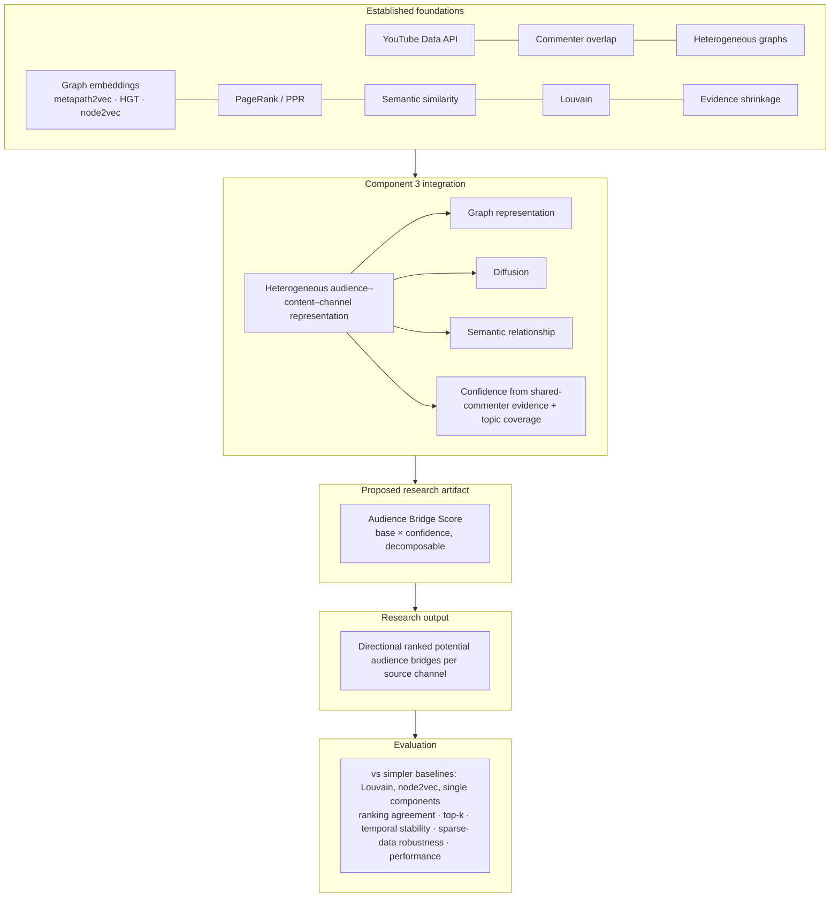

# Component 3: Research Position

*Diffusion-Based Cross-Channel Audience Bridge Scoring* · STEP 32 (literature gap, novelty validation and research positioning)

Companion documents:
- [component3_literature_gap_matrix.md](component3_literature_gap_matrix.md)
- [component3_novelty_threat_analysis.md](component3_novelty_threat_analysis.md)
- [component3_closest_work_comparison.md](component3_closest_work_comparison.md)
- [component3_scope_boundary.md](component3_scope_boundary.md)

> **How this audit was done:** a targeted (not systematic) web search of arXiv, AAAI/ICWSM, ACM, Springer and SAGE listings in October 2026. Its queries were deliberately chosen to find **overlapping or contradicting** work (YouTube commenter networks, co-commenter overlap, directed audience overlap, channel embeddings, PPR hybrids, evidence shrinkage). Some sources were read only at abstract or summary level, and each is marked so. Every "not found" below is **absence of evidence**, not proof of novelty. A systematic review (Google Scholar / Scopus / ACM DL, with forward and backward citation chasing from [R1], [R2], [R7]) is required before submission.

---

## Research Problem

A media organisation with many YouTube channels wants to know, for each channel, which of its other channels share or could reach a related audience: **potential cross-channel audience bridges**. Public data offers only partial evidence:
- who commented where
- what each channel publishes
- the multi-hop structure linking commenters, videos, channels and topics

The research question is how to turn this partial, noisy evidence into a **ranked, directional, explainable** list of potential bridges per source channel, and how far such a ranking agrees with simpler established methods.

## Existing Research

- **Commenter-overlap channel networks** are well established on YouTube and similar platforms:
  - radicalisation pathways [R1]
  - French political communication [R2]
  - BitChute [R3]
  - commenter-mob detection [R4, R5]
  - far-right channel overlap [R6]
  - K-pop virality brokers [R13]

  Overlap is mostly measured with Jaccard or overlap coefficients and analysed descriptively (density, communities, ERGMs, temporal migration).
- **Directional / asymmetric audience relations** are documented at **group level**: temporal migration between channel categories [R1], and conditional "% of A's commenters also on B" [R2].
- **Channel representations** combine social and semantic signals (Tube2Vec [R7]) or audience subscriptions (Clark & Zaitsev [R12]).
- **Established techniques** used by Component 3:
  - heterogeneous-graph representation learning: metapath2vec [F2], HGT [F3]
  - homogeneous embeddings: node2vec [F4]
  - community detection: Louvain [F5]
  - PageRank / PPR: [F1, F6], and PPR on heterogeneous graphs for hybrid recommendation [R9]
  - text embeddings: [F7]
  - evidence shrinkage of similarities: [R10, R11]

## Identified Gap

These signals exist **separately**:
- overlap statistics
- communities
- embeddings
- PPR proximity
- content similarity
- evidence shrinkage

Overlap studies on YouTube describe groups and communities rather than rank individual channel pairs. In this search we did **not** find work that combines heterogeneous commenter–video–channel–topic diffusion, learned graph similarity, content similarity and evidence-based confidence into a **directional, per-source ranking of potential audience bridges between channels**. Nor did we find such a ranking with an explainable decomposition, evaluated against community-detection and embedding baselines.

## Proposed Approach

```
public comments + video metadata (one immutable snapshot)
→ heterogeneous graph   commenter –comments→ video –belongs_to→ channel ; video –has_topic→ topic   (STEP 13)
→ graph features & shared-commenter evidence                                                      (STEP 14)
→ learned graph similarity   metapath2vec (primary) / HGT (alternative)                            (STEP 15–16)
→ diffusion                  Personalized PageRank from each channel                               (STEP 17)
→ content similarity         multilingual-E5 channel topic profiles                                (STEP 18)
→ Audience Bridge Score = (w_d·diffusion + w_e·embedding + w_t·topic) × [n/(n+k) × topic coverage]  (STEP 19)
→ per-source directional ranking, explanations                                                     (STEP 19, 22)
→ evaluation vs Louvain, node2vec and the score's own components                                   (STEP 20–21)
```

## Research Contribution

Conservative statement, retained after the audit:

> This research proposes a **confidence-weighted framework for ranking potential directional cross-channel audience bridges** by integrating heterogeneous audience–content–channel relationships, graph-based diffusion, learned graph similarity, semantic content similarity and evidence-quality factors. It evaluates the resulting ranking against established community-detection and graph-embedding baselines.

The statement was refined from the preferred direction in two ways:
1. It adds **learned graph similarity**, because the implemented score has three components.
2. It names the evaluation explicitly. The contribution is the **integrated, evaluated framework and its formulation**, not any individual technique.

### Contribution hierarchy (main conceptual diagram)



## Research Gap Statements

**Version 1 (slide):**
YouTube studies measure commenter overlap and communities between channels, but they do not rank, per channel, directional potential audience bridges by combining graph diffusion, learned graph similarity, content similarity and evidence quality. Component 3 proposes and evaluates such a ranking.

**Version 2 (TAF / proposal paragraph):**
Prior work shows that YouTube channels can be linked through shared commenters. This includes analysing communities, ideological pathways and coordinated behaviour, learning channel embeddings from social and semantic signals, and documenting asymmetric audience flows between channel groups. These analyses are mostly descriptive and group-level, and each uses one signal at a time. What remains unaddressed is a ranking for individual channels: given a source channel, which other channels are its strongest *potential* audience bridges, how confident can we be given the available public evidence, and why? This research proposes a confidence-weighted, directional Audience Bridge Score over a heterogeneous commenter–video–channel–topic graph. It combines Personalized PageRank diffusion, metapath2vec/HGT similarity and multilingual topic similarity, and evaluates it against Louvain and node2vec baselines. It treats the score as a research signal of potential audience affinity, not as evidence of migration or growth.

**Version 3 (thesis literature review):**
Research on YouTube audiences has repeatedly used public comments as a proxy for audience membership. Channel-level overlap networks built from shared commenters have been used to study radicalisation pathways [R1], political communication during elections [R2], alternative platforms [R3], coordinated commenter behaviour [R4, R5] and viral diffusion with broker channels [R13]. These works typically quantify overlap with symmetric measures such as Jaccard similarity and then characterise the resulting network through density, community structure or statistical network models. Some document directional or asymmetric relations: users migrating over time between channel categories [R1], and source-conditioned overlap percentages between channel groups [R2]. Others learn channel representations that capture social and semantic similarity [R7, R12]. Outside YouTube, Personalized PageRank [F1, F6] and heterogeneous-graph methods [F2, F3, R9] are standard for personalised, multi-signal recommendation. Evidence-based shrinkage of similarities is a long-standing practice in neighbourhood collaborative filtering [R10, R11].

Existing capabilities therefore include measuring overlap, detecting communities, embedding channels, computing graph proximity and discounting weakly supported similarities. The unresolved gap, as far as this review found, lies in **integrating** these capabilities for a different task: producing, for each source channel, a **directional, confidence-weighted and explainable ranking of potential audience bridges** that accounts for the following, and assessing how such a ranking relates to simpler established methods:
- multi-hop reachability in a heterogeneous audience–content graph
- learned structural similarity
- semantic content similarity
- the quantity and coverage of the supporting public evidence

Component 3 addresses this gap with the Audience Bridge Score. The contribution is positioned as a framework and formulation built from established components, not as a new algorithm.

## Novelty Boundaries

- **Definitely not novel:**
  - YouTube API collection
  - commenter overlap
  - heterogeneous graphs
  - metapath2vec, HGT, node2vec
  - PageRank / PPR
  - sentence-embedding topic similarity
  - Louvain
  - evidence shrinkage `n/(n+k)`
  - directional / asymmetric audience relations as a concept
  - additive score decomposition
- **Potential contribution (Category C):**
  - the integrated framework
  - the confidence formulation for this task (shared-commenter shrinkage × topic coverage, gating the score)
  - per-source directional bridge ranking combining all signals
- **Potentially novel formulation (Category D, pending systematic search):** the exact Audience Bridge Score specification.

## Closest Existing Work

| Work | Why it is close | Why it differs |
|---|---|---|
| Violot et al. 2025 [R2] | Channel–commenter bipartite graph and channel projection; asymmetric group overlap | Descriptive and group-level; Jaccard only; no diffusion, content similarity or ranking |
| Ribeiro et al. 2020 [R1] | Shared user base between channel categories; directional temporal migration | Category-level; temporal migration claim (which Component 3 explicitly avoids); no per-pair score |
| Tube2Vec [R7] | Social + semantic channel representations | Embeddings from sharing / recommendations, not commenter co-activity; no confidence-weighted directional ranking |
| PathRank [R9] | PPR on a heterogeneous graph mixing collaborative and content signals | User→item recommendation, not channel→channel audience bridges |
| Bell & Koren [R11] | Same shrinkage form `n/(n+λ)` | Collaborative filtering of ratings; Component 3 reuses the idea |

**Strongest existing overlap:**
- The *data signal and network* (commenter-overlap channel networks [R1, R2]).
- The *combination idea* of graph proximity plus content in a PPR-style ranker (PathRank [R9]).

## Remaining Novelty Risks

1. **Non-systematic search.** A closer YouTube or creator-economy paper (marketing / influencer-matching literature, Chinese-platform studies on Bilibili or Douyin, or industry "audience overlap" tools such as commenter-based overlap reports) may exist. Commercial tools already compute commenter-based audience overlap; this is non-academic but should be acknowledged.
2. **Partially read sources.** [R3], [R6], [R7], [R9], [R13] were assessed at abstract or summary level. In particular, Lee & Oh [R13] uses "broker" vocabulary close to "bridge" and must be read in full.
3. **Formula looks standard.** A weighted sum × support factor is a familiar pattern. Reviewers may see the score as engineering rather than method. Defend it by the **task** (directional audience-bridge ranking), the **evidence gate**, and **empirical results** (ablations).
4. **Direction is limited.** It comes only from PPR and per-source normalisation. Evidence and topic terms are symmetric. Overstating "directional" is a risk.
5. **No ground truth.** Evaluation measures consistency, not correctness. Current results show weak agreement with Louvain (Spearman ≈ 0.33) and weak inverse agreement with node2vec (≈ −0.29). That is informative about difference, not about which is better.
6. **Small, single-organisation channel set** (18 Derana channels). Generalisability is not shown.

## What Must Be Validated Experimentally

- **Ablations** (supported by the existing CLI and STEP 22 sensitivity):
  - full score vs no confidence
  - vs no diffusion
  - vs no embedding (two-part form)
  - vs no topic
  - metapath2vec vs HGT

  These show whether each part changes rankings.
- **A simple-overlap baseline:** rank destinations by shared commenters, Jaccard, or directional overlap share (`|C_s ∩ C_d| / |C_s|`). If the full framework agrees almost perfectly with this, the added complexity is not justified. *This baseline is not yet in STEP 21; adding it is recommended, as an evaluation addition, not a methodology change.*
- **Temporal predictive check:** whether bridges ranked from an earlier snapshot anticipate overlap growth in a later snapshot of the same channels. Report it as association, not causation.
- **Some external judgement:** a small expert-labelled set from the channel owner, so precision@k and NDCG can be reported instead of "labels unavailable".
- **Robustness:** sparse-data and temporal stability (already implemented) on more than one snapshot pair.

## Claims That Should NOT Be Made

- "first", "novel algorithm", "new algorithm", "unique", "first-ever", "no previous work", "never been studied"
- that commenter overlap, heterogeneous graphs, metapath2vec, HGT, PPR, topic similarity, node2vec, Louvain or confidence weighting are new
- that directional audience relationships are new
- audience migration, subscriber transfer, causality, future growth, guaranteed recommendations, demographic inference, complete audience representation (see [component3_scope_boundary.md](component3_scope_boundary.md))
- that the score is *accurate* or *validated* (no ground-truth labels)
- that interactions, video coverage or temporal support are part of the confidence (they are explanation evidence only)

---

## Documentation audit (§15 of STEP 32)

All Component 3 Markdown (`README.md`, `docs/**`, `research/component_3/README.md`, `frontend/README.md`, `backend/README.md`) was searched for: *first, novel, new algorithm, unique, first-ever, no previous work, never been studied, state-of-the-art, groundbreaking*.

- **Result:** no unsupported novelty claim was found. Every match of "first" or "unique" is technical (ordering, "unique commenters", "unique strings").
- **Existing positioning statements are already conservative:**
  - `docs/architecture/metapath2vec.md` ("metapath2vec itself isn't the research novelty…")
  - `docs/architecture/baselines.md` and `docs/architecture/supabase.md` ("not the proposed research contribution")
- **No text was reworded.** The only correction needed concerns the **STEP 32 brief itself**: the two-part formula and the confidence inputs. It is documented in [component3_novelty_threat_analysis.md §2–3](component3_novelty_threat_analysis.md).

---

## Final Decision

### MODERATE POTENTIAL CONTRIBUTION

Every building block is established, and the data signal (commenter-overlap channel networks) and the combination idea (graph proximity plus content in a PPR-style ranker) have clear precedents. The differentiation lies in the **task-specific integration**: a confidence-gated, directional, per-source, explainable ranking of potential cross-channel audience bridges over a heterogeneous commenter–video–channel–topic graph, evaluated against Louvain and node2vec. No closer match was found in this search. That is useful and defensible, but the overlap is substantial and the search was not systematic, so it does not qualify as a *strong* contribution.

**To move toward "strong":**
1. Run a systematic review to confirm the gap.
2. Show through ablations and a simple-overlap baseline that the integration changes rankings meaningfully.
3. Obtain even a small expert-labelled evaluation set.

**Methodological modification required?** **No critical issue.** Recommended, non-breaking items:
- state the three-part formula consistently in the proposal
- describe directionality accurately (PPR + per-source normalisation)
- add a simple-overlap baseline to the evaluation

The formula and pipeline were **not** changed.

---

## References

**Read levels:**
- **full**: the paper page or HTML was read
- **abs**: only the abstract or listing was read
- **sum**: known from a search summary only; verify before citing
- **std**: a standard foundational reference, not re-read in this step

*Foundational techniques*
- [F1] Page, L., Brin, S., Motwani, R., Winograd, T. (1999). *The PageRank Citation Ranking: Bringing Order to the Web.* Stanford InfoLab Technical Report. (std)
- [F2] Dong, Y., Chawla, N. V., Swami, A. (2017). *metapath2vec: Scalable Representation Learning for Heterogeneous Networks.* KDD. (std)
- [F3] Hu, Z., Dong, Y., Wang, K., Sun, Y. (2020). *Heterogeneous Graph Transformer.* WWW. (std)
- [F4] Grover, A., Leskovec, J. (2016). *node2vec: Scalable Feature Learning for Networks.* KDD. (std)
- [F5] Blondel, V. D., Guillaume, J.-L., Lambiotte, R., Lefebvre, E. (2008). *Fast unfolding of communities in large networks.* J. Stat. Mech. (std)
- [F6] Haveliwala, T. H. (2002). *Topic-Sensitive PageRank.* WWW. (std)
- [F7] Wang, L. et al. (2024). *Multilingual E5 Text Embeddings: A Technical Report.* arXiv:2402.05672. (std; the model used is `intfloat/multilingual-e5-small`)

*YouTube audience / channel networks*
- [R1] Horta Ribeiro, M., Ottoni, R., West, R., Almeida, V. A. F., Meira, W. (2020). *Auditing Radicalization Pathways on YouTube.* FAT* 2020. arXiv:1908.08313. (abs)
- [R2] Violot, C., Sosnovik, V., Humbert, M. (2025). *Exploring YouTube's Political Communication Networks during the 2024 French Elections.* arXiv:2512.04971. (full)
- [R3] Trujillo, M., Gruppi, M., Buntain, C., Horne, B. D. (2020). *What is BitChute? Characterizing the "Free Speech" Alternative to YouTube.* ACM Hypertext 2020 (long version arXiv:2004.01984). (abs; network details sum)
- [R4] Shajari, S., Alassad, M., Agarwal, N. (2023). *Commenter Behavior Characterization on YouTube Channels.* arXiv:2304.07681. (sum)
- [R5] Shajari, S., et al. (2023). *Detecting Suspicious Commenter Mob Behaviors on YouTube Using Graph2Vec.* arXiv:2311.05791. (sum)
- [R6] *The German Far-right on YouTube: An Analysis of User Overlap and User Comments.* ResearchGate publication 343792107; authors and venue to be verified. (sum)
- [R7] Boesinger, L., Horta Ribeiro, M., Veselovsky, V., West, R. (2023). *Tube2Vec: Social and Semantic Embeddings of YouTube Channels.* arXiv:2306.17298; listed in ICWSM proceedings (AAAI OJS 31450). (abs)
- [R12] Clark, S., Zaitsev, A. (2020). *Understanding YouTube Communities via Subscription-based Channel Embeddings.* arXiv:2010.09892. (abs)
- [R13] Lee, S. H., Oh, D. *Memes, gatekeepers, and the dynamics of viral K-pop diffusion on YouTube: Analyzing user engagement and network structures.* Convergence (online Dec 2025, DOI 10.1177/13548565251403999). (sum; authors and method to be verified)

*Recommendation, diffusion and evidence weighting*
- [R8] Shi, C., Hu, B., Zhao, W. X., Yu, P. S. *Heterogeneous Information Network Embedding for Recommendation (HERec).* arXiv:1711.10730 (IEEE TKDE). (abs)
- [R9] *PathRank: Ranking nodes on a heterogeneous graph for flexible hybrid recommender systems.* Expert Systems with Applications 189 (ORNL). Authors to be verified. (abs)
- [R10] Herlocker, J. L., Konstan, J. A., Borchers, A., Riedl, J. (1999). *An Algorithmic Framework for Performing Collaborative Filtering.* SIGIR. (abs; significance-weighting details sum)
- [R11] Bell, R. M., Koren, Y. (2007). *Improved Neighborhood-based Collaborative Filtering.* KDD Cup & Workshop. (shrinkage formula confirmed via secondary sources, sum)
- [R14] Gupta, P., Goel, A., Lin, J., Sharma, A., Wang, D., Zadeh, R. (2013). *WTF: The Who to Follow Service at Twitter.* WWW. (std; cited in the gap matrix as an example of PPR-based recommendation)
